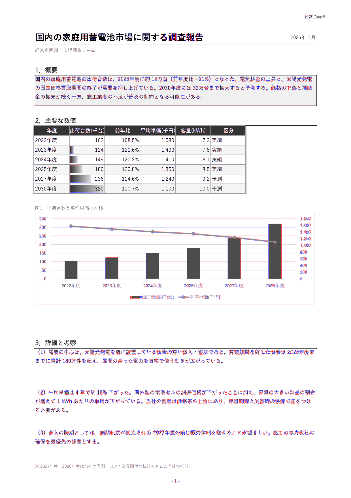

# xlsx2pdf

Excel ブック（.xlsx）を、Excel の「PDF として保存」とほぼ同じレイアウトで PDF に変換する Java のツールです。
Excel も LibreOffice も要りません。Java だけで動きます（Apache POI と Apache PDFBox を使っています）。

役所の申請書のように、罫線と文字の位置がそろっていることが大切な様式を、サーバーなどで PDF にしたい場合を想定しています。

## 特長

- **Excel と同じページ割り・位置・大きさ**: Excel は印刷や PDF への保存のとき、列幅や行の高さを「拡大縮小した後のフォントを、プリンタの
  解像度に合わせて丸めた大きさ」から計算するため、画面の寸法とは少し違います。本ツールはこの計算を再現しています。
- **Excel の出力との一致を実測**: 官公庁・自治体が公開している xlsx を Excel で PDF にした結果と、本ツールの出力をページの画像として重ね合わせて比べています（1.0 = 完全に一致）。比べたブックと評価のスクリプトは、公開ソースに含みません。

  一致率は、ページの長辺を約 700 画素の画像にして求めます。両方の暗い画素のうち、相手の同じ位置か周囲 1 画素以内にも暗い画素があるものの割合です。

  | 比べた PDF | 件数 | 一致率の平均 | ページ数が同じ |
  |---|---|---|---|
  | Microsoft 365 で PDF に保存したもの | 1,060 件 | 0.996 | 1,060 件 |
  | Excel 2024 で PDF に保存したもの | 733 件 | 0.996 | 732 件 |
  | Excel 2021 で PDF に保存したもの | 733 件 | 0.997 | 733 件 |
  | 役所などが Web で公開している PDF（`--author-env`） | 739 件 | 0.903 | 722 件 |
  | 官公庁・自治体が公開している xlsx の代表を、Excel 2024 で PDF に保存したもの | 5,976 件 | 0.992 | 5,945 件 |

  役所などの PDF は、作った人の PC で出力されたものです。Excel の版や画面の表示倍率が分からないため、ファイルの情報から推測して合わせています。

  **重ね合わせの例**（一致率 0.998）: 表・グラフ・文章を含む報告書（架空のデータで作った市場調査の報告書）を、Excel の PDF と本ツールの PDF で重ねた画像です。黒は両方が一致した部分、赤は Excel だけ、青は本ツールだけにある部分です。データバー付きの表、縦棒と第 2 軸の折れ線の複合グラフ、折り返した文章、ヘッダー・フッターを含みます。

  

  一致率が同じくらいでも、差の目立ち方はブックによって違います。文字の折り返し位置が変わるブックでは、差がより目立ちます。
- **日本語の様式に強い**: 和暦・曜日などの日本語の表示形式、縦書き、均等割り付け、ＭＳ 系フォントの字送りなど。
- **外部ソフト不要・ネットワーク不要**: 変換はすべてプロセスの中で行います。

## バージョン

0.1.2

## 動作環境

- Java 17 以上
- Windows / macOS / Linux

## ダウンロードとファイル

次の 2 つの jar を使います。作り方は「[ビルド](#ビルド)」を見てください。

| ファイル | 内容 |
|---|---|
| `xlsx2pdf.jar` | 本体（実行可能 jar。依存ライブラリを同梱） |
| `xlsx2pdf-fonts.jar` | 代替フォント（IPA フォントなど）。`xlsx2pdf.jar` と同じフォルダに置くと自動で使われます（使い方は「[代替フォント（xlsx2pdf-fonts.jar）の使い方](#代替フォントxlsx2pdf-fontsjarの使い方)」） |

`xlsx2pdf-fonts.jar` は、Excel のフォント（ＭＳ ゴシック、游ゴシックなど）が入っていない環境（Linux サーバーなど）で使います。
Office の入った Windows のように実際のフォントがある環境では、`xlsx2pdf.jar` だけでも動きます。

## 使い方

```
java -jar xlsx2pdf.jar <入力.xlsx> <出力.pdf> [オプション]
```

既定では、非表示でないシートをすべて、ブックの順に 1 つの PDF に出力します（印刷するものがないシートは出力しません）。
印刷範囲・改ページ・拡大縮小・ヘッダー/フッターなどは、ブックの印刷設定に従います。

### どの Excel の出力に合わせるか

同じ xlsx でも、Excel で「PDF として保存」した結果は、保存した PC によって少し変わります（文字や罫線の位置、行の高さ、
ページの区切りなど）。主な違いは「Excel の版」と「Windows の画面の表示倍率（100% / 125% / 150% など）」です。どの PC で
PDF にしたかはファイルに記録されないため、本ツールは合わせる先を次の 3 つから選べるようにしています。

| 合わせる先 | 指定 | こんなときに |
|---|---|---|
| **今の Excel で、表示倍率 100% の PC で PDF に保存した結果**（既定） | なし | 手元の Excel で PDF にするのと同じ結果にしたい。ふつうはこれ |
| 今の Excel で、表示倍率 125% / 150% などの PC で PDF に保存した結果 | `--screen-dpi 125%` など | 表示倍率を上げた PC の Excel と同じにしたい |
| ファイルを作った人が、自分の PC で PDF に保存した結果 | `--author-env` | 役所などが公開している「Excel ファイルと PDF の組」の PDF に近づけたい |

Excel から PDF 用のプリンタ（Microsoft Print to PDF など）へ印刷した場合も、配置の計算は「PDF として保存」と同じです。

- 「今の Excel」は Microsoft 365 / Excel 2021 / 2024 です（これらの間で出力はほぼ同じです）。
- `--author-env` は、ファイルに残っている手がかり（最後に保存した Excel の版、作った PC の画面に由来する列幅や行の高さの端数）
  から、作った人の環境（Excel 2010 / 2013 などの古い版、表示倍率 125% / 150% の画面）を推測して合わせます。推測なので、
  外れることがあります。
- `--author-env` と `--screen-dpi` を両方指定すると、画面の表示倍率は `--screen-dpi` の値を使い、版は推測します。

### 利用例

```sh
# いちばん簡単な使い方
java -jar xlsx2pdf.jar 申請書.xlsx 申請書.pdf

# 特定のシートだけ (複数指定できます。名前に空白があれば引用符で囲みます)
java -jar xlsx2pdf.jar 様式集.xlsx 様式1.pdf --sheet "様式第1号" --sheet "様式第2号"

# Excel の「作業中のシートを印刷」と同じ (選択中のシートだけ)
java -jar xlsx2pdf.jar 様式集.xlsx 作業中.pdf --active-only

# パスワード付きのブック
java -jar xlsx2pdf.jar 秘密.xlsx 秘密.pdf --password 'パスワード'

# Windows のフォントをコピーしたフォルダを追加で使う (Linux サーバーで Excel と同じ字形にしたいとき)
java -jar xlsx2pdf.jar 申請書.xlsx 申請書.pdf --font-dir /opt/fonts/windows

# 用紙サイズが設定されていないブックを A3 で出力する
java -jar xlsx2pdf.jar 図面.xlsx 図面.pdf --default-paper A3

# 画面の表示倍率を 150% にしている PC の Excel で PDF に保存した結果に合わせる
java -jar xlsx2pdf.jar 申請書.xlsx 申請書.pdf --screen-dpi 150%

# ファイルを作った人が出力した PDF (公開されている PDF など) に近づける
java -jar xlsx2pdf.jar 申請書.xlsx 申請書.pdf --author-env

# 信頼できないファイルを変換するサービスで、時間の上限を 60 秒にする
java -jar xlsx2pdf.jar 受付.xlsx 受付.pdf --timeout 60

# 大きなファイルを、時間とメモリを掛けてでも変換する (上限を外し、Java に 16GB 使わせる)
java -Xmx16g -jar xlsx2pdf.jar 大きな台帳.xlsx 台帳.pdf --no-limits
```

### オプション

| オプション | 説明 |
|---|---|
| `--sheet NAME` | 指定したシートだけを出力します（複数指定可）。名前で指定したシートは非表示でも出力します。 |
| `--active-only` | 選択中（アクティブ）のシートだけを出力します（Excel の「作業中のシートを印刷」と同じ）。 |
| `--recalc` | 数式を再計算してから出力します。既定は、ファイルに保存されている計算結果（最後に保存したときの値）を使います。プログラムで値だけを書き換えたブックや、TODAY() などを今日の値で印刷したいときに使います。計算できない数式（対応していない関数など）は保存されている結果のまま出力し、その件数を警告に出します。 |
| `--password PW` | 暗号化されたブックのパスワード。 |
| `--no-edit` | PDF の編集を禁止します（内容の変更、注釈やフォームの記入、ページの組み替え）。印刷と文字のコピーはできます。開くときのパスワードは付きません。 |
| `--owner-password PW` | 編集の禁止を解除するためのパスワード（権限パスワード）。指定すると `--no-edit` も有効になります。指定しなければ、知らせない乱数のパスワードになり、後から解除できません。 |
| `--font-dir DIR` | フォントを探すフォルダを追加します（複数指定可）。ここにあるフォントが最も優先されます。 |
| `--font-cache-dir DIR` | フォントのキャッシュを置くフォルダ（既定 `~/.cache/xlsx2pdf`。なければ作ります）。「[フォントのキャッシュ](#フォントのキャッシュ)」を参照。 |
| `--no-font-cache` | フォントのキャッシュを使いません（読まず、書きません）。 |
| `--default-paper P` | ブックに用紙サイズがないときの用紙（A4, A3, A5, B4, B5, Letter, Legal, Tabloid）。既定は A4（日本語版 Windows のプリンタの既定と同じ）。`--author-env` のときは、日本語のブックなら A4、それ以外は Letter。 |
| `--excel-page-size` | 拡大縮小して印刷するシートのページを「用紙サイズ ÷ 倍率」の大きさにし、内容もその分だけ拡大して描きます。例: A4 で倍率 50% のシートは、A4 の縦横 2 倍のページになります。一部の Excel が作る PDF のページの大きさに合わせたいときに使います。既定は実際の用紙サイズ。 |
| `--screen-dpi N` | 合わせたい Excel の PC の画面の DPI（96 dpi = 表示倍率 100%、120 dpi = 125%、144 dpi = 150%、192 dpi = 200%）。`150%` のように表示倍率でも書けます。既定は 96 dpi（100%）。`--author-env` のときの既定はファイルから推定します。 |
| `--author-env` | ファイルを作った人の環境（Excel の版・画面の表示倍率）をファイルから推測し、その人が出力した PDF に近づけます（上の「どの Excel の出力に合わせるか」）。既定は、今の Excel で表示倍率 100% の PC で PDF に保存した結果に合わせます。 |
| `--printer-dpi N` | 合わせたい Excel で選んでいたプリンタの解像度を、すべてのシートに使います（既定 600。Microsoft Print to PDF は 600）。`--use-file-dpi` より優先します。 |
| `--use-file-dpi` | シートごとに、ブックに保存されたプリンタの解像度でレイアウトします（既定はブックの値を使わず、常に 600 dpi）。 |
| `--max-pages N` | 作るページ数の上限（既定 10,000。0 = 無制限）。 |
| `--max-image-pixels N` | 1 枚の画像の画素数の上限（既定 5,000 万。超える画像は描きません。0 = 無制限）。 |
| `--max-zip-entry-mb N` | xlsx（zip）の中の 1 項目の展開後の大きさの上限（既定 1024 MB。0 = 無制限）。 |
| `--max-zip-entries N` | xlsx（zip）の中の項目の数の上限（既定 100,000。0 = 無制限）。 |
| `--timeout SEC` | 変換の時間の上限（秒。既定 0 = 無制限）。セルの行や図形ごとに確かめますが、ブックの読み込みと PDF の保存の途中では止まりません。確実に止める必要があるときは、別のプロセスで動かし、呼び出し側で時間を測って終了させてください。 |
| `--no-limits` | 上の上限をすべて外します。`java -Xmx16g` のように十分なメモリも与えてください。 |
| `--verbose` | 想定外のエラーの詳細（スタックトレース）を表示します。 |

編集の禁止は、PDF ビューアーが設定を守ることが前提です。Adobe Acrobat など主なビューアーは守りますが、制限を無視したり解除したりするソフトもあるため、改ざんを確実に防ぐものではありません。

上限は、悪意のあるファイル（数 KB で数千万ページになるもの、展開すると巨大になる zip など）でメモリや時間を使い切られない
ためのものです。超えると変換を中止し、緩めるオプションを表示します。

### 終了コード

| コード | 意味 |
|---|---|
| 0 | 成功 |
| 1 | 変換できない（xlsx として読めない、パスワードが違う、想定外のエラーなど） |
| 2 | 引数の誤り（不明なオプションなど） |
| 3 | 上限を超えた（ページ数・zip の大きさ）、またはメモリ不足 |
| 4 | 時間切れ（`--timeout`） |

失敗したときは、途中まで書いた出力ファイルを残さず、もとからあった出力ファイルはそのまま残します。入力と出力に同じファイルを指定するとエラー (終了コード 2) になります。

## フォント

文字は、次の順にフォントを探して描きます。**`--font-dir` を指定しなくても、Windows のフォントフォルダは自動で参照します。**

1. `--font-dir` で指定したフォルダ
2. OS のフォントフォルダ（自動）
   - Windows: `C:\Windows\Fonts`、ユーザーのフォント（`%LOCALAPPDATA%\Microsoft\Windows\Fonts`）
   - WSL（Windows 上の Linux）: `/mnt/c/Windows/Fonts`
   - macOS: `/Library/Fonts`、`~/Library/Fonts`
   - Linux: `/usr/share/fonts`、`/usr/local/share/fonts`、`~/.fonts`、`~/.local/share/fonts`
3. 同梱の代替フォント（`xlsx2pdf-fonts.jar`）。字幅が互換のフォントで、Excel のフォントが見つからないときに使います。

| Excel のフォント | 代替フォント |
|---|---|
| ＭＳ ゴシック / ＭＳ Ｐゴシック / ＭＳ 明朝 / ＭＳ Ｐ明朝 | IPAゴシック / IPAPゴシック / IPA明朝 / IPAP明朝 |
| 游ゴシック・メイリオなど / 游明朝 | IPAexゴシック / IPAex明朝 |
| Calibri / Cambria | Carlito / Caladea |
| Arial / Times New Roman / Courier New | Liberation Sans / Serif / Mono |

Windows で Excel と同じ字形にしたい場合は、何も指定しなくて構いません。Linux サーバーなどで Excel と同じ字形にしたい場合は、
使用許諾の範囲で Windows のフォントを用意し、`--font-dir` でそのフォルダを指定してください。HG 系のフォント（HG丸ｺﾞｼｯｸM-PRO など）や
Century は Office に付属するフォントなので、Office の入っていない PC にはありません。

`xlsx2pdf-fonts.jar` も代わりのフォントもない場合は、PC に入っている似たフォントで代用し、その旨を表示します。
それも見つからなければ、変換を始める前に止まります。

### フォントのキャッシュ

フォントフォルダの中のどのファイルがどの書体かを調べた結果を、既定で `~/.cache/xlsx2pdf/fonts-*.tsv`
（Windows では `C:\Users\<ユーザー名>\.cache\xlsx2pdf`）に保存し、次の変換から使います。フォルダがなければ作ります。
フォントファイルの大きさと更新日時が変わったものだけを読み直します。キャッシュは消しても構いません（次の変換で作り直します）。

- 場所を変える: `--font-cache-dir DIR`（API では `opt.fontCacheDir`）
- 使わない: `--no-font-cache`（API では `opt.noFontCache = true`）。読み書きしない代わりに、変換のたびにすべてのフォントファイルを読むので遅くなります
  （WSL で Windows のフォントを読む場合は 1 回あたり 20〜30 秒）。

キャッシュを書けない場合（ホームが読み取り専用など）は、キャッシュなしで変換を続けます。

## バッチファイルやプログラムから使う

### 代替フォント（xlsx2pdf-fonts.jar）の使い方

**`xlsx2pdf.jar` と同じフォルダに、同じ名前のまま置くだけです。** 設定やオプションは要りません。コマンド、バッチファイル、Java プログラムのどれでも同じです。

```
フォルダ/
├ xlsx2pdf.jar
└ xlsx2pdf-fonts.jar
```

**必要かどうか**: 実際のフォントがあれば、そちらが使われます。代替フォントが使われるのは、フォントが PC に見つからないときだけです。

| 環境 | `xlsx2pdf-fonts.jar` | 理由 |
|---|---|---|
| Office の入った Windows | なくても動きます | ＭＳ ゴシックや游ゴシックなどが PC にあります |
| Linux サーバー、コンテナ | **置いてください** | Excel のフォントがありません。ほかにフォントがなければ、これがないと変換できません |

**置き方ごとの動き**:

| 置き方 | 結果 |
|---|---|
| 同じフォルダに同じ名前で置く | 使われます。`java -jar` でも、`java -cp xlsx2pdf.jar` でも同じです |
| `xlsx2pdf-fonts.jar` の名前を変える | **使われません** |
| `xlsx2pdf.jar` の名前を変える | 使われます |
| 別のフォルダに置く | 下のように `-cp` で両方を指定すれば使われます。`java -cp ... -jar ...` は `-cp` が無視されるので使われません |

```sh
# Linux・macOS (区切りは :)
java -cp lib/xlsx2pdf.jar:fonts/xlsx2pdf-fonts.jar xlsx2pdf.Main 申請書.xlsx 申請書.pdf
```

```bat
rem Windows (区切りは ;)
java -cp "lib\xlsx2pdf.jar;fonts\xlsx2pdf-fonts.jar" xlsx2pdf.Main 申請書.xlsx 申請書.pdf
```

自分のアプリから使うときも、`xlsx2pdf-fonts.jar` がクラスパスに入っていれば使われます。

**使われているかの確かめ方**: どちらの場合も、フォントが足りないと次のメッセージで分かります。

| 状態 | 動き |
|---|---|
| `xlsx2pdf-fonts.jar` がなく、PC に似たフォントがある | 「注意: 同梱フォント (xlsx2pdf-fonts.jar) がないため、PC のフォントで代用します」と表示して変換します |
| `xlsx2pdf-fonts.jar` がなく、PC に似たフォントもない | 「代わりに使うフォントが見つかりません」で止まります（終了コード 1。プログラムからは `FontUnavailableException`） |

どのフォントがどの代替フォントになるかは「[フォント](#フォント)」を見てください。

### Windows のバッチファイル（.bat）から使う

バッチファイルから `java -jar` で実行できます。先に Java 17 以上を入れ、コマンドプロンプトで `java -version` が動くことを確かめてください。
以下の例は、`xlsx2pdf.jar`（必要なら `xlsx2pdf-fonts.jar` も）とバッチファイルを同じフォルダに置く前提です。`xlsx2pdf-fonts.jar` の指定は要りません。

#### 例 1: 1 つのファイルを変換する

終了コードで成功と失敗を判定します。`cd /d "%~dp0"` は、バッチファイルのあるフォルダに移動する指定です。

```bat
@echo off
cd /d "%~dp0"

java -jar xlsx2pdf.jar "申請書.xlsx" "申請書.pdf"
if errorlevel 1 (
    echo 変換に失敗しました。終了コード: %ERRORLEVEL%
    exit /b %ERRORLEVEL%
)
echo 変換しました
```

#### 例 2: ドラッグ＆ドロップで変換する

xlsx ファイルをバッチファイルの上にドロップすると、同じフォルダに同じ名前の PDF を作ります。

```bat
@echo off
if "%~1"=="" (
    echo xlsx ファイルをこのバッチファイルにドロップしてください
    pause
    exit /b 2
)

java -jar "%~dp0xlsx2pdf.jar" "%~1" "%~dpn1.pdf"
if errorlevel 1 pause
```

`%~1` はドロップしたファイル、`%~dpn1` はその拡張子を除いたパス、`%~dp0` はバッチファイルのあるフォルダです。失敗したときだけ `pause` で画面を残します。

#### 例 3: フォルダの中をまとめて変換する

`入力` フォルダの xlsx をすべて変換し、`出力` フォルダに PDF を作ります。1 件失敗しても残りを続け、最後に失敗の件数を表示します。

```bat
@echo off
cd /d "%~dp0"
if not exist "出力" mkdir "出力"

set FAILED=0
for %%f in ("入力\*.xlsx") do (
    echo %%~nxf
    java -jar xlsx2pdf.jar "%%~f" "出力\%%~nf.pdf"
    if errorlevel 1 (
        echo 失敗: %%~nxf
        set /a FAILED+=1
    )
)

echo 失敗: %FAILED% 件
if not "%FAILED%"=="0" exit /b 1
```

#### バッチファイルでの注意点

| 項目 | 内容 |
|---|---|
| `%` の書き方 | **`%` は `%%` と書きます。** `--screen-dpi 150%%` が正しい指定です。`150%` と書くと `%` が消えて `150` dpi の指定になり、エラーにならないまま出力が変わります。パスワードなど、ほかの引数の `%` も同じです |
| 引用符 | 日本語や空白を含むパスは `"..."` で囲みます |
| 文字コード | バッチファイルは Shift-JIS（メモ帳の「ANSI」）で保存します。UTF-8 で保存すると、日本語のファイル名を正しく渡せないことがあります |
| 終了コード | `if errorlevel 1` は「終了コードが 1 以上」の意味です。コードごとに分けるときは `if %ERRORLEVEL%==3` のように書きます。`for` や `if` の括弧の中で数値を見るときは `setlocal EnableDelayedExpansion` と `!ERRORLEVEL!` を使います |
| PDF を開いたまま | 出力先の PDF を別のアプリで開いていると書き込めず、終了コード 1 になります。開いている PDF はそのまま残ります |
| Java が見つからない | 「'java' は、内部コマンドまたは外部コマンド…として認識されていません」と出たら、Java のパスが通っていません。`"C:\Program Files\...\bin\java.exe" -jar ...` のように Java の場所を指定しても動きます |

### Java プログラムから使う

```java
import xlsx2pdf.Converter;
import xlsx2pdf.LimitExceededException;
import java.io.File;

Converter.Options opt = new Converter.Options();
opt.sheets.add("様式第1号");       // --sheet
opt.timeoutSeconds = 60;            // --timeout
// opt.screenDpi = 144;             // 画面の DPI。--screen-dpi 150% と同じ (96 dpi × 150% = 144 dpi)
// opt.authorEnv = true;            // --author-env
// opt.recalc = true;               // --recalc (数式を再計算してから出力)
// opt.noEdit = true;               // --no-edit
// opt.fontCacheDir = new File("/var/cache/xlsx2pdf"); // --font-cache-dir
// opt.noFontCache = true;          // --no-font-cache
// opt.useFileDpi = true;           // --use-file-dpi
// opt.noLimits();                  // --no-limits

try {
    new Converter(opt).convert(new File("申請書.xlsx"), new File("申請書.pdf"));
} catch (LimitExceededException e) {
    // 上限を超えた・時間切れ (e.isTimeout())
}
```

変換は、1 つのセルや図形を描けなくても止めずに最後まで続けます。描けなかったものは `getWarnings()` で一覧を受け取れます。コマンドラインでは、標準エラーに `警告: ...` と表示します。

```java
Converter conv = new Converter(opt);
conv.convert(new File("申請書.xlsx"), new File("申請書.pdf"));
for (String w : conv.getWarnings()) {
    System.err.println(w);   // 例: シート「様式1」: 図形を描けませんでした (NullPointerException)
}
```

`xlsx2pdf.jar` をクラスパスに加えて使います。`xlsx2pdf-fonts.jar` は同じフォルダに置けば自動で使われます（別のフォルダならクラスパスに加えます）。

### 別のプロセスで呼ぶ（アプリが別の版の POI・PDFBox を使うとき）

`xlsx2pdf.jar` は Apache POI 5.5.1 と Apache PDFBox 3.0.8 を同梱しています。アプリがこれらの別の版を使っているときは、同じプロセスに入れると、どちらの版が使われるかが決まらず、正しく動かないことがあります。そのようなときは、`java -jar xlsx2pdf.jar` を別のプロセスとして呼び出してください。

別のプロセスにすると、次の利点もあります。

- `--timeout` で止まらない処理 (ブックの読み込み、PDF の保存) も、呼び出し側でプロセスごと止められます。
- 変換でメモリを使い切っても、アプリには影響しません。

```java
import java.io.File;
import java.io.IOException;
import java.nio.charset.StandardCharsets;
import java.nio.file.Files;
import java.util.List;
import java.util.concurrent.TimeUnit;

public class ProcessExample {
    /** xlsx を PDF にする。失敗したら例外。警告の行 (「警告: ...」) を返す。 */
    public static List<String> toPdf(File jar, File xlsx, File pdf, long timeoutSeconds)
            throws IOException, InterruptedException {
        File log = File.createTempFile("xlsx2pdf", ".log");
        try {
            // 標準エラーの文字コードを UTF-8 に固定する (Java 17 は sun.*、18 以降は std*.encoding)
            Process p = new ProcessBuilder("java", "-Dsun.stdout.encoding=UTF-8", "-Dsun.stderr.encoding=UTF-8",
                    "-Dstdout.encoding=UTF-8", "-Dstderr.encoding=UTF-8",
                    "-jar", jar.getPath(), xlsx.getPath(), pdf.getPath())
                    .redirectErrorStream(true)          // 標準エラー (警告・エラー) もまとめて
                    .redirectOutput(log)                // ファイルに書く (出力が詰まって止まらないように)
                    .start();
            if (!p.waitFor(timeoutSeconds, TimeUnit.SECONDS)) {
                p.destroyForcibly().waitFor();          // 時間切れは強制終了する
                throw new IOException("時間切れです: " + xlsx);
            }
            List<String> lines = Files.readAllLines(log.toPath(), StandardCharsets.UTF_8);
            if (p.exitValue() != 0) {
                // 1 変換できない、2 引数の誤り、3 上限超過、4 時間切れ (--timeout)
                throw new IOException("変換できませんでした (終了コード " + p.exitValue() + "): " + String.join(" ", lines));
            }
            return lines.stream().filter(l -> l.startsWith("警告: ")).toList();
        } finally {
            log.delete();
        }
    }
}
```

- 警告は標準エラーに `警告: ...` の形で出るので、出力から受け取れます。終了コードは 0 のままです。
- 出力は一時ファイルに書いています。標準出力を読まずに待つと、出力が多いときにプロセスが止まることがあるためです。
- メッセージの文字コードは OS や Java の版で変わるので、`-Dstderr.encoding=UTF-8` などで UTF-8 に固定し、UTF-8 で読みます。

### ストリームで変換する

ファイルを介さずに `InputStream` から `OutputStream` へ変換できます。Web アプリでアップロードされたブックを変換して返す場合や、
クラウドのストレージとやり取りする場合に使います。

| 動き | 内容 |
|---|---|
| 一時ファイル | 作りません。入力を読み込み、メモリの中で PDF を完成させます |
| 出力のタイミング | PDF が完成してから `out` に書きます。変換に失敗したときは何も書きません |
| ストリームを閉じる | `convert` は閉じません。開いた側で閉じてください |
| 入力の上限 | 既定で 1GB。超えると `LimitExceededException` になります（`opt.maxInputBytes` で変更） |
| ブック名 | ストリームには名前がないので、`opt.sourceName` で渡します。ヘッダーやフッターのファイル名（`&F`）と、PDF のタイトルに使います。省略するとファイル名は空になり、タイトルは設定されません。ヘッダーやフッターのパス（`&Z`）は常に空です |

#### 例 1: ストリームの基本

ファイルのストリームで書いていますが、`InputStream` と `OutputStream` であれば何でも同じです。そのまま実行できます。

```java
import java.io.InputStream;
import java.io.OutputStream;
import java.nio.file.Files;
import java.nio.file.Path;

import xlsx2pdf.Converter;

public class StreamExample {
    public static void main(String[] args) throws Exception {
        Converter.Options opt = new Converter.Options();
        opt.sourceName = "申請書.xlsx";

        // try-with-resources で、開いたストリームを閉じる
        try (InputStream in = Files.newInputStream(Path.of("申請書.xlsx"));
             OutputStream out = Files.newOutputStream(Path.of("申請書.pdf"))) {
            new Converter(opt).convert(in, out);
        }
    }
}
```

注意: `Files.newOutputStream` は開いた時点でファイルを空にするので、この例では変換に失敗すると空のファイルが残ります。
失敗時に既存のファイルを残したいときは、`convert(File, File)` を使ってください。

#### 例 2: バイト配列で受け渡す

データベースやメッセージキューなど、データがバイト配列で手元にある場合です。

```java
import java.io.ByteArrayInputStream;
import java.io.ByteArrayOutputStream;
import java.io.IOException;

import org.apache.poi.openxml4j.exceptions.InvalidFormatException;
import xlsx2pdf.Converter;

public class BytesExample {
    /** xlsx のバイト列を PDF のバイト列にする。 */
    public static byte[] toPdf(byte[] xlsx, String name) throws IOException, InvalidFormatException {
        Converter.Options opt = new Converter.Options();
        opt.sourceName = name;

        ByteArrayOutputStream pdf = new ByteArrayOutputStream();
        new Converter(opt).convert(new ByteArrayInputStream(xlsx), pdf);
        return pdf.toByteArray();
    }
}
```

#### 例 3: Web アプリで変換して返す

アップロードされたブックを PDF にして返すサーブレットです（Jakarta Servlet 5 以降）。利用者のファイルは信頼できないので、
上限を厳しくして、失敗の種類ごとにエラーを返します。

```java
import java.io.IOException;
import java.io.InputStream;

import jakarta.servlet.ServletException;
import jakarta.servlet.annotation.MultipartConfig;
import jakarta.servlet.annotation.WebServlet;
import jakarta.servlet.http.HttpServlet;
import jakarta.servlet.http.HttpServletRequest;
import jakarta.servlet.http.HttpServletResponse;
import jakarta.servlet.http.Part;

import org.apache.poi.openxml4j.exceptions.InvalidFormatException;
import xlsx2pdf.Converter;
import xlsx2pdf.LimitExceededException;

@WebServlet("/xlsx2pdf")
@MultipartConfig
public class PdfServlet extends HttpServlet {
    @Override
    protected void doPost(HttpServletRequest request, HttpServletResponse response) throws IOException, ServletException {
        Part upload = request.getPart("file");
        if (upload == null) {
            response.sendError(HttpServletResponse.SC_BAD_REQUEST, "file がありません");
            return;
        }

        // Options と Converter はリクエストごとに作る (同じ Converter を共有すると順番に処理される)
        Converter.Options opt = new Converter.Options();
        opt.sourceName = "upload.xlsx";          // 利用者が付けた名前をそのまま PDF に入れない
        opt.maxInputBytes = 20L * 1024 * 1024;   // 入力は 20MB まで
        opt.maxPages = 1000;                     // 1000 ページまで
        opt.timeoutSeconds = 60;                 // 60 秒まで

        response.setContentType("application/pdf");
        response.setHeader("Content-Disposition", "attachment; filename=\"output.pdf\"");

        try (InputStream in = upload.getInputStream()) {
            // 成功したときだけ response に書かれる。response のストリームはサーブレットコンテナが閉じる
            new Converter(opt).convert(in, response.getOutputStream());
        } catch (LimitExceededException e) {
            // 上限を超えた。e.isTimeout() なら時間切れ
            fail(response, HttpServletResponse.SC_REQUEST_ENTITY_TOO_LARGE, e.isTimeout() ? "時間切れです" : "ファイルが大きすぎます");
        } catch (IllegalArgumentException | InvalidFormatException e) {
            // xlsx として読めない (POI の NotOfficeXmlFileException などは IllegalArgumentException の仲間)
            fail(response, HttpServletResponse.SC_BAD_REQUEST, "xlsx として読めないファイルです");
        } catch (IOException e) {
            // .xls、パスワード付きのブック、zip 爆弾の疑い、利用者との接続の切断など
            fail(response, HttpServletResponse.SC_BAD_REQUEST, "変換できませんでした");
        }
    }

    /** エラーを返す。PDF を送り始めた後 (接続の切断など) は返せないので何もしない。 */
    private static void fail(HttpServletResponse response, int status, String message) throws IOException {
        if (!response.isCommitted()) response.sendError(status, message);
    }
}
```

ポイント:

- **エラーを返せる**: 変換に失敗したときは `response` に何も書かれていないので、ステータスコードを変えてエラーを返せます。
- **メモリ**: 入力と完成した PDF を両方メモリに置きます。同時に変換する数とブックの大きさに合わせて、`-Xmx` を決め、同時実行数を制限してください。
- **実行時の例外**: `LimitExceededException`、`FontUnavailableException`（使えるフォントがない）、POI の例外は実行時例外（`RuntimeException`）で、`throws` には現れません。
- **メモリ不足**: `OutOfMemoryError` は上の例では受けていません。上限を決めて起こさないようにするのが基本です。

### 同時に変換する

1 つのプロセスの中で、複数の変換を同時に実行できます。スレッドごとに `Converter` を作ってください（同じ `Converter` を共有すると順番に処理します）。zip の大きさと圧縮率の上限はプロセス全体で共通で、最後に変換を始めたものの設定が使われます。同時に変換するなら、この上限は同じ値にそろえてください。

## 対応している機能

- **セル**: 値と表示形式（和暦・曜日・日本語の組込み書式・会計の `*` 埋め・色指定・条件付きの区画）、フォント、塗りつぶし（単色・パターン・
  グラデーション）、罫線（全種類・斜線）、配置（折り返し・はみ出し・縮小して全体を表示・均等割り付け・選択範囲内で中央・縦書き・回転・字下げ）、
  結合セル、リッチテキスト、条件付き書式（塗り・フォント・罫線・カラースケール・データバー・アイコンセット）、ゼロ値の非表示、セル内のチェックボックス・画像、
  ふりがな、テーブル・ピボットテーブルのスタイル、スパークライン
- **印刷設定**: 用紙・向き・余白・拡大縮小・次のページ数に合わせて印刷・印刷範囲（複数範囲）・印刷タイトル行/列・改ページ・ページの順序・
  水平/垂直の中央・枠線と行列番号の印刷・先頭ページ番号・白黒印刷・簡易印刷・コメントの印刷（画面表示イメージ・シートの末尾）・
  右から左のシート・数式の表示で保存したシート・グラフシート
- **ヘッダー/フッター**: 左/中央/右、ページ番号・総ページ数・日付・時刻・ファイル名・シート名・パス、フォント・大きさ・太字・斜体・下線・
  取り消し線・上付き/下付き・色、長い文字の折り返し、画像（大きさ・切り抜き・グレースケール・明るさ）、先頭ページ/奇数偶数ページ別
- **オブジェクト**: 図形（プリセット形状すべて・ユーザー定義の形状）、線・矢印、グラデーション、影、画像（トリミング、EMF/WMF）、
  テキストボックス、グループ、コネクタ、SmartArt、フォームコントロール（チェックボックス・オプションボタンなど）、ActiveX コントロールの画像、
  グラフ（棒・折れ線・面・円・ドーナツ・散布図・レーダー・バブル・株価・等高線・3D・補助円、ウォーターフォール・じょうご・ヒストグラム・
  パレート図・箱ひげ図・ツリーマップ・サンバースト）、スライサー・タイムライン、数式（OMML）、SVG の画像

## 制限事項

- 対応する形式は .xlsx（Office Open XML）だけです。古い .xls は対象外です。暗号化された .xlsx は `--password` で変換できます。
- Excel の列幅・行の高さは、PDF に保存する PC の画面の表示倍率や Excel の版、選んでいるプリンタによってわずかに変わります。
  本ツールの既定は「今の Excel で、表示倍率 100% の PC で PDF に保存した結果」です。ほかの環境に合わせたい場合は `--screen-dpi`・`--printer-dpi`・
  `--author-env` を使ってください（「どの Excel の出力に合わせるか」）。
- グラフは主な種類に対応していますが、細かな書式は Excel と異なる場合があります。
- マクロ（VBA）は実行しません。数式は、ファイルに保存された計算結果を表示します（`--recalc` で再計算できます。対応していない関数は保存された結果のままです）。
- Strict OOXML 形式で保存された .xlsx も読めます (名前空間をメモリ上で通常の形に書き換えます)。

## ビルド

JDK 17 以上と Maven 3.9 以上が必要です。単体テストも `mvn package` の中で実行します。

```sh
mvn package
# target/xlsx2pdf.jar        本体
# target/xlsx2pdf-fonts.jar  代替フォント
```

## ライセンス

本ツールのソースは [MIT License](LICENSE) で公開しています。Copyright (c) 2026 tomoaki bessho。

配布する jar は、次の第三者のソフトウェアやフォントを含みます。それぞれのライセンスに従います。

| 含まれるもの | ライセンス | 全文の場所 |
|---|---|---|
| Apache POI、Apache PDFBox、Apache XMLBeans、Apache Commons、Apache Log4j API、SparseBitSet | Apache License 2.0 | `xlsx2pdf.jar` の `META-INF/third-party/` |
| curvesapi | BSD 3-Clause License | `xlsx2pdf.jar` の `META-INF/third-party/` |
| IPA フォント | IPA フォントライセンス v1.0 | `xlsx2pdf-fonts.jar` の `fonts/` |
| Carlito、Caladea、Liberation | SIL Open Font License 1.1 | `xlsx2pdf-fonts.jar` の `fonts/` |
| DejaVu Sans | Bitstream Vera ライセンスなど | `xlsx2pdf-fonts.jar` の `fonts/` |
| ワードアートの変形の形の定義 (presetTextWarpDefinitions.xml) | ECMA-376 第 5 版 Part 1 (2016 年 12 月) の付属ファイル。Copyright © Ecma International | `xlsx2pdf.jar` の `xlsx2pdf/` |

Apache License 2.0 の帰属表示 (NOTICE) は、`META-INF/third-party/NOTICE.txt` にまとめています。本ツールのライセンスは jar の直下の `LICENSE` にあります。

## 商標

Microsoft、Excel、Windows は Microsoft Corporation の商標です。本ツールは Microsoft とは関係のない独立したソフトウェアです。
